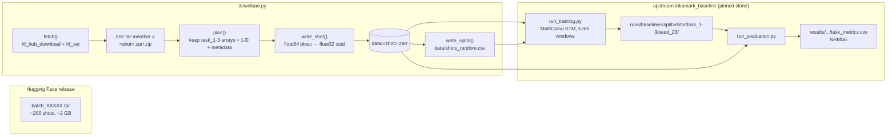
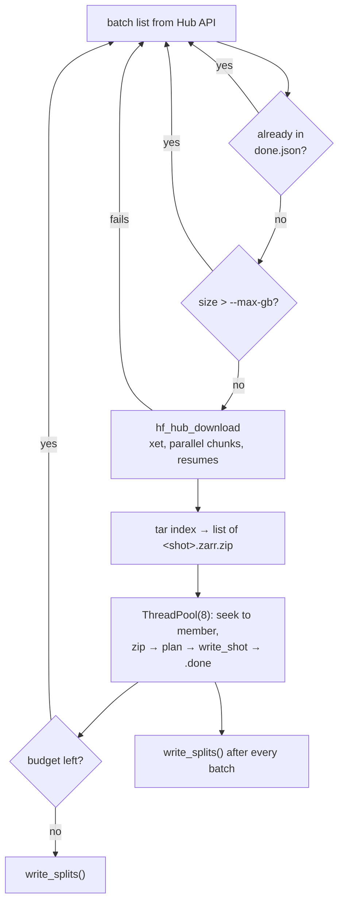

# TokaMark LSTM baseline — architecture and flow

Reproduce the upstream **TokaMark** CNN+LSTM baseline on **task_1-3** (Markovian equilibrium
reconstruction: 8 magnetics/PF/summary signals → the 65×65 flux map ψ) on Kaggle's free 2×T4 box,
so later models (CTC / LNN) have a same-data baseline to beat.

Everything here is about one problem: **the official dataset cannot be streamed from its S3
endpoint in a session-length amount of time**, so the pipeline fetches the same bytes from the
Hugging Face release instead and keeps only what the task reads.

---

## 1. Why the data path looks like this

| Measured on the public S3 bucket (`s3.echo.stfc.ac.uk`, anon) | Value |
| --- | --- |
| Objects per shot (zarr store, 8 groups) | **285** |
| Bytes per shot | 3.2 MB |
| Sequential GET latency | 0.56 s |
| Throughput at 16 / 64 / 256 concurrent GETs | 17.3 / 18.8 / 18.5 req/s |
| Implied time for 11.5k shots (3.2 M GETs) | **≈ 45 h** |

Throughput is flat from 16 workers upward and matches from two independent networks (local box
18.5 req/s, Kaggle 21.6 req/s), so the ceiling is the endpoint, not the client. Client-side
concurrency, batching or connection tricks cannot fix it; only fetching **fewer, larger objects**
can.

The Hub release (`UKAEA-IBM-STFC/tokamark-v1`) ships the identical data as **58 `batch_*.tar`
files** (~565 GB, ~200 shots per tar). One HTTP transfer replaces 285 GETs, so the same data
arrives 20–100× faster, and only the arrays task_1-3 reads are written to disk.

Verified identical to the bucket: for shot 11766, ψ max |Δ| = 7.5e-9, `flux_loop_flux` Δ = 0,
`ip` Δ = 0 (float32 rounding only).

---

## 2. System map



Five files are ours; the model, task definition, loader, transforms and metric are the upstream
code, untouched except for one optional config key (see §6).

| File | Responsibility |
| --- | --- |
| `download.py` | Hub → lean local zarr + per-split shot lists. Time-boxed, resumable. |
| `run.py` | One baseline run: preflight, train, evaluate, print NRMSE. |
| `kaggle_main.py` | Session driver: install, download with a budget, one run per GPU, copy artifacts to `/kaggle/working`. |
| `setup.sh` | Pinned clones, deps, applies `patches/tokamark_baseline.patch`. |
| `configs/baseline.yaml` | Upstream config, local paths, `data_splits_dir`. |

---

## 3. The lean shot

A shot on the Hub is a zip of the whole zarr store (~10 MB on the small batches, up to ~200 MB on
the 15 large ones). `plan()` keeps:

* every **array of task_1-3** — `equilibrium/psi`, `magnetics/{flux_loop_flux,
  b_field_pol_probe_ccbv_field, b_field_pol_probe_obr_field, b_field_pol_probe_obv_field,
  b_field_tor_probe_saddle_voltage}`, `pf_active/{coil_current, solenoid_current}`, `summary/ip`;
* **every 1-D array** in those four groups (time axes, channel maps — a chunk or two each, and the
  loader may look at them);
* group/root metadata (`.zgroup`, `.zattrs`, `.zarray`).

Then:

* float64 blosc chunks are decoded, cast to float32 and re-encoded as zstd → **half the bytes**,
  and the loader casts to float32 anyway;
* `.zmetadata` (consolidated) is filtered to exactly the members kept — the loader opens stores
  with consolidated metadata, so a stale `.zmetadata` raises `KeyError`;
* the shot lands in `data/<shot>.zarr/.done` only after the whole store is written.

Result: **~65 objects and 1.5 MB per shot instead of 285 objects / 3.2 MB**, ~5 shots/s on 8
threads (blosc and zlib release the GIL).

---

## 4. Flow: one Kaggle session

```
[0]   setup.sh        clone tokamark + tokamark_baseline (pinned), install deps, apply patch   ~2 min
[1]   download.py     75 min budget, batches in order, each batch → ~200 lean shots
[2]   write_splits()  official random split ∩ shots on disk → data/shots_random.csv
[3]   run.py          one LSTM run on the random split (GPU0+GPU1, DataParallel)
[4]   run.py          evaluation runs even if training hit its timeout (best_model.pt)
[5]   kaggle_main.py  copy runs/ + results/ into /kaggle/working/out, print last 6 log lines
```

Timeline inside the 12 h cap (`kaggle_main.py`):

| Phase | Budget | Note |
| --- | --- | --- |
| install | ~2 min | |
| data | 75 min | exits early if all 43 small batches are done |
| training | everything left − 20 min | `run.py --timeout`, then evaluates |
| evaluation + copy | ~20 min | |

The data budget is a **deadline, not a quota**: whatever arrives is used, so a slow session trains
on fewer shots instead of running out of time. At 100 MB/s the 75 min are enough for all 43 small
batches (90 GB, ~8 600 shots); at 20 MB/s it lands ~7 batches (~1 400 shots).

### Download loop (per batch)



Failure model: a bad shot is logged (`FAILED <shot>: …`) and skipped; a bad batch is skipped and
retried next run; a killed run keeps every finished shot, keeps `.part`-free xet cache state, and
`done.json` remembers processed tars. `write_splits()` runs after **every** batch, so a session
that dies still leaves usable split files.

---

## 5. Splits contract

Upstream always reads the full official split CSV (11 574 shots) and would ask the loader for
shots that are not on disk. So:

* `download.py` writes `data/shots_random.csv` — the official random rows, restricted to the shots
  present, so **train/val/test membership is still the paper's**;
* `configs/baseline.yaml` sets `data_splits_dir: /../../data`;
* the training and evaluation entry points read the random split CSV from there when the key is present.

The split change is a no-op when the key is absent. `patches/tokamark_baseline.patch` also makes training
epoch-based (validate, checkpoint and early-stop once per epoch; `max_epochs`, `patience` in epochs) and wraps
the model in `DataParallel` when more than one GPU is visible. Those are the only changes to upstream.

---

## 6. Deviations from upstream, and what they cost

| Deviation | Reason | Consequence |
| --- | --- | --- |
| Hub tars instead of S3 GETs | S3: ~45 h for the set | same bytes, verified equal |
| Subset of shots (time-boxed) | 565 GB / 11.5k shots does not fit a session | NRMSE will not match the paper's table; comparisons between our models stay valid because both see the identical subset |
| Only task_1-3 arrays, float32 zstd | 285 → 65 objects, half the bytes | loader output unchanged (same values to float32 precision) |
| `shuffle: false` | deterministic shot order between runs | upstream ships `true` |
| `data_splits_dir` patch | see §5 | no-op upstream |

Reproducing the paper's exact numbers needs the full 43 small batches plus the 15 large ones
(565 GB) and a longer training budget than one session allows; everything here scales up by
raising `--minutes` / `--max-gb`, nothing else changes.

---

## 7. Commands

```bash
# one-off
bash setup.sh

# data (repeatable; resumes where it stopped)
python download.py                    # ~60 min budget
python download.py --minutes 20       # short pull
python download.py --batches 2        # just batch_00000/00001
python download.py --max-gb 40        # allow the 15 large batches too

# train + evaluate the random split
python run.py --model lstm --gpu 0,1
python run.py --model cnn --timeout 600   # cheap pipeline check

# whole Kaggle session
python kaggle_main.py
```

Artifacts: `runs/baseline/<split>/<model>/task_1-3/seed_<n>/` (checkpoints, logs) and
`external/tokamark_baseline/results/<split>/<model>/seed_<n>/task_metrics.csv` (NRMSE per feature,
`n_shots` tells you exactly how many test shots the number is based on).

### Kaggle notebook setup

1. Accelerator **GPU T4**, Internet **on**.
2. Upload this zip as a dataset, attach it.
3. One cell: `!python /kaggle/input/<dataset>/kaggle_main.py`
4. **Save Version → Save & Run All** (background run survives the tab).

`/kaggle/temp` holds the downloaded shots (not saved as output); `out/` in `/kaggle/working`
holds the logs and metrics, so the next session re-downloads data but keeps the results.
